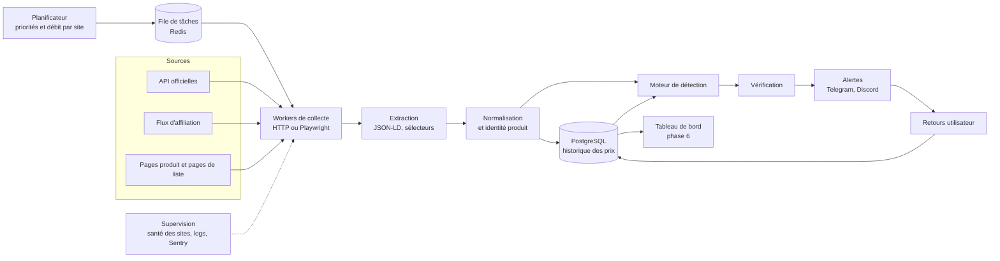

# Architecture

## Vue d'ensemble



Chaque brique est indépendante et testable seule. Ajouter un site revient à écrire un
connecteur et sa configuration, sans toucher au reste.

---

## 1. Sources de données

Par ordre de préférence :

| Source | Avantages | Inconvénients | Usage |
|---|---|---|---|
| **API de données** (Keepa pour Amazon) | Fiable, structurée, autorisée, plusieurs pays, historique inclus | Payante, quota de jetons | **Source Amazon** si l'option de budget C est choisie (voir [SITES.md](SITES.md)) |
| **API officielle** (ex. Creators API d'Amazon) | Fiable, structurée, autorisée | Réservée aux affiliés qui génèrent des ventes | Écartée pour un usage personnel |
| **Flux produits d'affiliation** (Awin, Effiliation, Kwanko, Rakuten…) | Catalogue complet avec EAN, autorisé | Inscription avec un site ou une chaîne, mise à jour souvent quotidienne | Écartés pour un usage personnel |
| **Données structurées des pages** (JSON-LD schema.org `Product`/`Offer`) | Résiste aux refontes visuelles, une seule méthode pour beaucoup de sites | Il faut récupérer la page | Collecte principale par défaut |
| **Pages de liste** (catégories, recherche) | 20 à 60 prix par requête | Moins de détails, EAN souvent absent | Balayage large |
| **Sélecteurs HTML propres au site** | Fonctionne partout | Fragile, demande de la maintenance | Solution de secours |
| **Communautés de bons plans** | Vérité terrain, couvrent les sites bloqués | L'erreur est déjà publique | Signal secondaire, mesure du rappel |

## 2. Planificateur

Le planificateur décide **quoi vérifier et quand**, dans la limite du débit autorisé pour chaque site.

- Chaque offre a une `priority` et une date `next_check_at`.
- Intervalle de vérification = `intervalle_de_base / poids`. Le poids augmente avec la valeur
  du produit, sa volatilité, l'historique d'erreurs du site et la popularité de la catégorie.
- Chaque site dispose d'un **budget de requêtes** (ex. 1 requête toutes les 2 s). Le planificateur ne le dépasse jamais.

### Calcul de capacité

À 1 requête toutes les 2 secondes, un site donne **1 800 pages par heure** :

| Méthode | Prix obtenus par heure et par site |
|---|---|
| Pages produit (1 prix par page) | 1 800 |
| Pages de liste (environ 48 prix par page) | environ 86 000 |

La stratégie en découle : **balayer large avec les pages de liste, vérifier avec les pages
produit**. Une baisse repérée sur une liste déclenche immédiatement une vérification de la page produit.

## 3. Collecte

- `httpx` asynchrone, délais d'attente stricts.
- Nouvelles tentatives avec attente croissante sur les erreurs 5xx et 429, en respectant l'en-tête `Retry-After`.
- Limite de débit par domaine (token bucket) et requêtes conditionnelles (`ETag`, `If-Modified-Since`).
- User-Agent identifiable, avec une URL de contact.
- `robots.txt` lu, mis en cache et respecté, avec `protego`. Le module standard de Python
  (`urllib.robotparser`) ne gère pas les jokers `*` qu'utilisent LDLC, Rue du Commerce ou Electro Dépôt.
- Playwright (navigateur sans interface) seulement pour les sites qui affichent le prix en JavaScript.
  Il est 10 à 50 fois plus coûteux qu'une requête HTTP.
- Option : conserver le HTML brut compressé pendant quelques jours, pour déboguer et rejouer les extracteurs.
- **Aucun contournement des protections** (CAPTCHA, blocage d'IP, pages nécessitant un compte).
  Si un site bloque, on passe par son API ou son flux, ou on le retire. Voir [JURIDIQUE.md](JURIDIQUE.md).

## 4. Extraction

Les méthodes sont essayées dans cet ordre : JSON-LD, puis microdata, puis balises OpenGraph
(`product:price:amount`), puis sélecteurs CSS propres au site.

Le résultat est un objet `RawOffer` (Pydantic) : titre, prix, devise, prix barré, disponibilité,
état, vendeur, EAN, ASIN ou référence fabricant, URL, image.

Pièges à couvrir par des tests :

- Prix au format français : `1 299,99 €`, espaces insécables, centimes dans une balise séparée.
- Prix mensuel (« 39 €/mois »), prix « à partir de », prix avec reprise ou avec offre de remboursement.
- Prix d'une autre variante (couleur, capacité) que celle affichée.
- Éco-participation affichée à part.
- Prix barré pris pour le prix réel, et inversement.

**Les prix sont manipulés avec `Decimal`, jamais avec `float`.**

## 5. Normalisation

- Devise au format ISO 4217 et conversion en euros (taux quotidiens de la BCE).
- Prix TTC, frais de port séparés.
- Pays du site et **livraison vers la France** (oui, non ou inconnu).
- **Prix rendu en France** pour les offres hors UE : prix, livraison, TVA à l'importation et
  droits de douane estimés. La détection compare ce prix-là, pas le prix affiché.
- État : `new`, `refurbished` ou `used`.
- Vendeur : le marchand lui-même ou un vendeur tiers de marketplace (nom et note si disponibles).
- Disponibilité : `in_stock`, `out_of_stock`, `preorder` ou `unknown`.
- GTIN/EAN validé par sa clé de contrôle.

## 6. Identité produit

Pour comparer un même produit chez plusieurs marchands :

1. **GTIN/EAN** : identifiant le plus fiable.
2. **ASIN**, ou **marque et référence fabricant**.
3. **Similarité de titres** par embeddings (phase 5), pour les produits sans identifiant.

Le modèle distingue le **produit** (un objet du monde réel) de l'**offre** (ce produit, chez
tel marchand, vendu par tel vendeur, dans tel état).

## 7. Modèle de données

```text
retailer            id, name, domain, country, currency, enabled, config (jsonb)
product             id, gtin, brand, mpn, asin, title, category
offer               id, product_id?, retailer_id, url, seller, condition,
                    priority, next_check_at, last_checked_at
price_observation   id, offer_id, observed_at, price, shipping, currency,
                    list_price, availability          -- uniquement quand quelque chose change
anomaly             id, offer_id, detected_at, price, reference_price, ratio,
                    score, signals (jsonb), status, screenshot_path, resolved_at
alert               id, anomaly_id, channel, sent_at, message_id, feedback, feedback_at
connector_health    retailer_id, window_start, requests, successes, parse_failures
```

Volume : en stockant seulement les changements, 100 000 offres représentent quelques dizaines
de milliers de lignes par jour, ce que PostgreSQL gère sans difficulté. TimescaleDB ne devient
utile qu'au-delà de plusieurs millions d'offres.

## 8. Détection et vérification

Voir [DETECTION.md](DETECTION.md).

## 9. Alertes

- **Telegram** (aiogram) : canal principal, instantané, avec boutons de retour.
- Webhook Discord et récapitulatif par e-mail en option.
- Un canal développeur séparé pour les pannes et les connecteurs cassés.
- Les limites d'envoi de Telegram sont respectées grâce à une file d'envoi.

Exemple de message :

```text
🚨 ERREUR DE PRIX PROBABLE (score 92/100)
Téléviseur OLED 55" Marque X (EAN 1234567890123)
💶 129,90 € au lieu d'environ 1 299 € (-90 %)
🔎 Signaux : virgule décalée ×10 · -90 % sur la médiane 30 j · -90 % sur 4 autres marchands
🏪 Vendu et expédié par ExempleShop · En stock · Neuf
🕒 Détecté à 14:32 (prix précédent relevé à 14:17)
⚠️ Le marchand peut annuler la commande.
[Voir l'offre]   [✅ Erreur]   [🏷️ Promo]   [🐛 Bug]
```

## 10. Supervision

- Indicateurs par connecteur : taux de succès, taux d'échec d'extraction, temps de réponse, codes HTTP.
- **Canaris** : quelques produits au prix connu et stable, vérifiés en continu. Si leur prix
  extrait change bizarrement, c'est l'extracteur qui est cassé.
- Si les anomalies se multiplient d'un coup sur un même site, les alertes de ce site sont
  suspendues et un humain vérifie. Il peut s'agir d'un bug de collecte ou d'une vraie erreur de prix massive.
- Message quotidien « le bot fonctionne » avec les statistiques du jour.
- Sentry pour les exceptions, logs JSON (structlog). Prometheus et Grafana plus tard si besoin.

## 11. Stack technique

| Besoin | Choix recommandé | Alternatives |
|---|---|---|
| Langage | **Python 3.12+** (meilleur écosystème pour la collecte et l'analyse de données) | – |
| Outillage | uv, ruff, mypy, pytest, pre-commit | Poetry |
| HTTP | httpx (asynchrone) | aiohttp |
| Navigateur | Playwright | – |
| Analyse HTML | selectolax ou parsel | BeautifulSoup |
| Données structurées | extruct | – |
| `robots.txt` | protego | – |
| Modèles | Pydantic v2 | – |
| Base de données | PostgreSQL (SQLite possible pour le MVP) | – |
| ORM et migrations | SQLAlchemy 2 et Alembic | SQLModel |
| File de tâches | Redis et ARQ | Celery, Dramatiq |
| Telegram | aiogram 3 | python-telegram-bot |
| API et tableau de bord | FastAPI (avec HTMX ou un petit front) | Django |
| Supervision | structlog, Sentry | Prometheus et Grafana |
| Déploiement | Docker Compose sur l'ordinateur personnel (option A), puis un VPS si besoin. GitHub Actions pour la CI | – |
| Surveillance de disponibilité | Healthchecks.io (offre gratuite) : prévient si le bot ne donne plus signe de vie | – |

Pour un balayage à grande échelle, Scrapy est une alternative crédible à httpx avec un
planificateur maison : limitation de débit intégrée, respect de `robots.txt`, pipelines.

## 12. Structure du dépôt (cible)

```text
.
├── pyproject.toml
├── docker-compose.yml
├── Dockerfile
├── .env.example
├── config/
│   ├── retailers/              # un fichier YAML par site
│   └── detection.yaml          # seuils et poids
├── src/pricebot/
│   ├── cli.py                  # pricebot run | check <url> | backtest
│   ├── settings.py
│   ├── domain/                 # modèles Pydantic : RawOffer, Offer, Anomaly…
│   ├── fetch/                  # client HTTP, limitation de débit, robots.txt, Playwright
│   ├── extract/                # JSON-LD, microdata, OpenGraph, sélecteurs
│   ├── connectors/
│   │   ├── base.py             # interface Connector
│   │   └── <site>.py
│   ├── normalize/              # devises, EAN, état, vendeur
│   ├── storage/                # SQLAlchemy, dépôts, migrations Alembic
│   ├── scheduler/
│   ├── detection/              # références, signaux, score, vérification
│   ├── alerts/                 # telegram, discord, email
│   ├── monitoring/             # santé des connecteurs, canaris
│   └── api/                    # tableau de bord (phase 6)
├── tests/
│   ├── fixtures/html/          # pages enregistrées pour tester les extracteurs
│   ├── fake_shop/              # faux magasin local pour les tests de bout en bout
│   └── ...
└── docs/
```

## 13. Configuration et secrets

- Les secrets (`TELEGRAM_BOT_TOKEN`, `DATABASE_URL`, clés d'API) sont dans `.env`, qui n'est
  **jamais committé**. Un fichier `.env.example` sans valeurs sert de modèle.
- Un fichier YAML par site :

```yaml
id: exemple-shop
name: Exemple Shop
domain: www.exemple-shop.fr
country: FR
currency: EUR
enabled: true
rate_limit:
  min_interval_seconds: 2      # au plus 1 requête toutes les 2 s
  max_concurrency: 1
render_js: false
extraction: [jsonld, microdata, opengraph, selectors]
selectors:                      # secours si les données structurées manquent
  price: "span.product-price"
  title: "h1"
legal:                          # repris de la fiche site
  robots_txt_checked: 2026-11-05
  tos_reviewed: 2026-11-05
  notes: "Pas d'interdiction explicite de la collecte automatisée"
```

## 14. Stratégie de tests

| Niveau | Contenu |
|---|---|
| Unitaires | Lecture des prix (formats FR), validation EAN, calcul des signaux et du score |
| Extracteurs | Pages HTML réelles enregistrées dans `tests/fixtures`, avec le résultat attendu |
| Détection | Séries de prix synthétiques : promo normale, virgule décalée, bruit, rupture de stock |
| Bout en bout | Faux magasin local dont on change les prix, puis vérification de l'alerte reçue |
| Rejeu (backtest) | Historique réel rejoué avec de nouveaux paramètres, puis mesure de la précision et du rappel |
