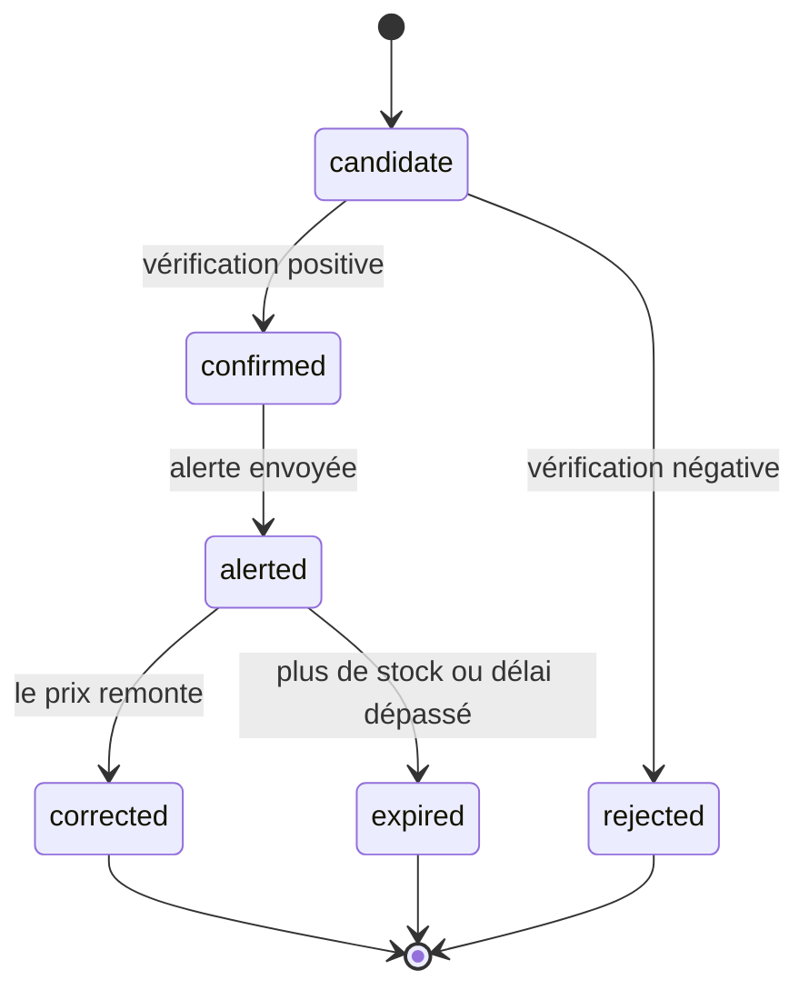

# Moteur de détection

## 1. Qu'est-ce qu'une erreur de prix ?

Une erreur de prix est un **prix affiché nettement plus bas que celui que le marchand voulait
afficher**, à cause d'une erreur humaine ou technique. Une promotion, elle, est volontaire.

Le bot ne peut pas connaître l'intention du marchand. Il estime une **probabilité** d'erreur à
partir de signaux, puis la confirme par une vérification.

## 2. Types d'erreurs visés

| Type | Exemple | Ce qui la trahit |
|---|---|---|
| Virgule ou zéro décalé | 1 299 € affiché 129,90 € | Prix × 10 ou × 100 ≈ prix habituel |
| Remise mal saisie | -90 % au lieu de -9 % | Rapport ≈ 0,1 et prix barré incohérent |
| Mauvaise devise | Prix en couronnes affiché en euros | Rapport ≈ taux de change |
| Prix d'un autre produit ou variante | Téléviseur au prix de son support mural | Prix proche de celui d'un accessoire |
| Erreur de flux ou d'import | Toute une catégorie à 1 € | Beaucoup d'anomalies en même temps sur un site |
| Prix de remplissage | 0,00 €, 0,01 €, 1 € | Valeurs typiques sur un produit cher |
| Cumul de remises | Code promo, remise panier et offre de remboursement | Visible seulement au panier (hors périmètre au début) |

## 3. Prix de référence

Il faut d'abord savoir ce que vaut normalement le produit.

| Référence | Calcul | Disponible |
|---|---|---|
| `P_hist` | Médiane des prix de l'offre sur 30 jours, hors épisodes anormaux | Après environ 7 jours d'historique |
| `P_marché` | Médiane des prix du même EAN chez les autres marchands (neuf, en stock, vendu par le marchand) | Dès le premier jour si l'EAN est connu |
| `P_barré` | Prix barré affiché par le site | Immédiatement, mais peu fiable |
| `P_précédent` | Dernier prix observé | Dès la deuxième observation |

**Règle** : `P_ref` est la **plus basse** des références fiables disponibles (`P_hist` et
`P_marché`, à défaut `P_barré`). Ce choix prudent évite de croire à une baisse de -80 %
calculée sur un prix barré gonflé.

Sans aucune référence fiable, l'offre est surveillée mais ne peut pas déclencher d'alerte.

## 4. Signaux

Le rapport principal est `r = P / P_ref`.

| # | Signal | Calcul | Seuil initial |
|---|---|---|---|
| S1 | Baisse par rapport à la référence | `r` | `r < 0,5` |
| S2 | Virgule décalée | `P × 10` ou `P × 100` à ±10 % de `P_ref` | oui ou non |
| S3 | Baisse brutale | `P / P_précédent` en une seule observation | `< 0,6` |
| S4 | Écart statistique | z-score robuste de `log(P)` sur l'historique : `(log P − médiane) / (1,4826 × MAD)` | `z < −6` |
| S5 | Incohérence interne | Remise affichée différente de la remise calculée, prix très inférieur aux autres variantes | écart > 20 points |
| S6 | Montant en jeu | `P_ref − P` en euros | ≥ 30 € |
| S7 | Prix de remplissage | `P` ∈ {0 ; 0,01 ; 1} alors que `P_ref` > 50 € | oui ou non |

Tous les seuils sont dans `config/detection.yaml` et peuvent être réglés par catégorie.

## 5. Pénalités et filtres

Ces cas ressemblent à des erreurs de prix mais n'en sont pas, ou sont dangereux :

| Cas | Traitement |
|---|---|
| **Vendeur tiers de marketplace** récent ou avec peu d'avis | Forte pénalité : c'est souvent une **arnaque**, pas une erreur |
| Produit reconditionné, d'occasion ou « comme neuf » | Pénalité, ou comparaison avec la référence du même état |
| Prix « à partir de », mensuel, location, avec reprise | Rejet : prix mal interprété |
| Produit en rupture ou en précommande lointaine | Pénalité : on ne peut pas acheter |
| Soldes, Black Friday, déstockage | Seuils relevés (ex. `r < 0,4` au lieu de `r < 0,5`) |
| Produit en fin de vie (nouvelle génération sortie) | Pénalité légère |
| Beaucoup d'anomalies en même temps sur un site | Mise en attente et vérification manuelle (bug de collecte ou erreur massive) |

## 6. Score de confiance

```text
score = borner( Σ poids_i × signal_i − Σ pénalités , 0 , 100 )
```

Les poids sont réglés à la main au début (phase 3), puis appris à partir des retours (phase 5).

| Score | Action |
|---|---|
| ≥ 80 | Vérification rapide, puis alerte immédiate |
| 50 à 79 | Vérification complète, alerte seulement si elle est confirmée |
| 30 à 49 | Enregistré et visible dans le tableau de bord, sans alerte |
| < 30 | Ignoré |

## 7. Vérification

Chaque candidat passe par ces étapes avant d'être signalé :

1. **Nouvelle collecte immédiate**, si possible par une autre méthode (page produit si le prix
   vient d'une liste, API si elle existe). Le prix doit être confirmé.
2. **Contrôle du stock, du vendeur et de l'état.**
3. **Capture d'écran horodatée** (Playwright), qui sert de preuve et permet un contrôle visuel rapide.
4. *(Phase 5)* **Vérification par un LLM** pour les cas ambigus : il reçoit le texte de la page
   et le candidat, et répond de façon structurée (bon produit ? neuf ? vendu par le marchand ?
   prix TTC réel ? conditions cachées ?).
5. **Décision** : alerte, ou rejet avec sa raison enregistrée pour analyse.

Le bot n'ajoute rien au panier et ne passe aucune commande.

## 8. Cycle de vie d'une anomalie



- **Une seule alerte par épisode.** Une nouvelle alerte n'est envoyée que si le prix baisse
  encore d'au moins 20 %.
- Un message de suivi est envoyé à la correction (« ✅ prix corrigé après 47 min »). La
  **durée de vie des erreurs** par site est mesurée et sert à régler la fréquence de vérification.

## 9. Exemples

**Virgule décalée** : alerte.
- Historique sur 30 jours : médiane de 1 299 €. Quatre autres marchands : médiane de 1 279 €. Donc `P_ref` = 1 279 €.
- Nouveau prix : 129,90 €. `r` = 0,10 (S1 ✔). 129,90 × 10 = 1 299 €, à +1,6 % de `P_ref` (S2 ✔). 1 149 € en jeu (S6 ✔).
- Vendu par le marchand, neuf, en stock : aucune pénalité. **Score d'environ 95 : alerte immédiate.**

**Vraie promotion** : pas d'alerte.
- Casque à 349 €, affiché 199 € pendant le Black Friday. `r` = 0,57, au-dessus du seuil de soldes de 0,4.
- **Score d'environ 35 : enregistré, sans alerte.**

**Arnaque sur une marketplace** : pas d'alerte.
- Console à 499 €, proposée à 89 € par un vendeur tiers créé il y a 3 jours et sans aucun avis. S1 ✔, mais la pénalité est maximale.
- **Score d'environ 20 : pas d'alerte.** Une option peut l'afficher dans un canal « ⚠️ suspect ».

## 10. Évaluation

- Chaque alerte notée (✅, 🏷️ ou 🐛) enrichit un **jeu de données étiqueté**.
- **Précision** = alertes utiles / alertes envoyées.
- **Rappel** = erreurs connues détectées / erreurs connues. Les erreurs connues viennent des
  communautés de bons plans et des vérifications manuelles.
- Tout changement de seuil ou de poids est d'abord **rejoué sur l'historique** (backtest). Il
  n'est déployé que s'il améliore la précision sans dégrader le rappel.
